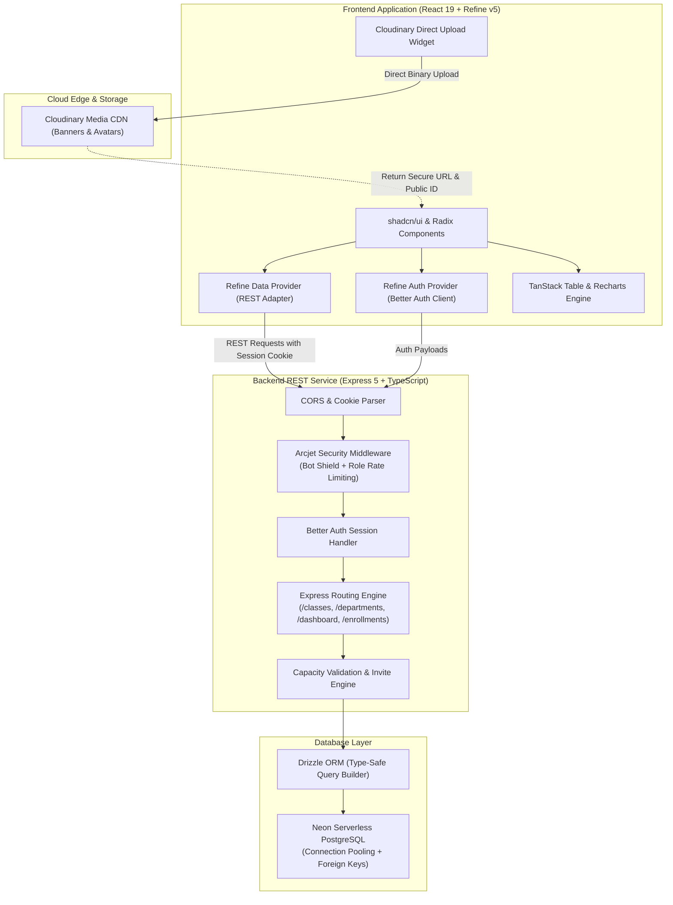
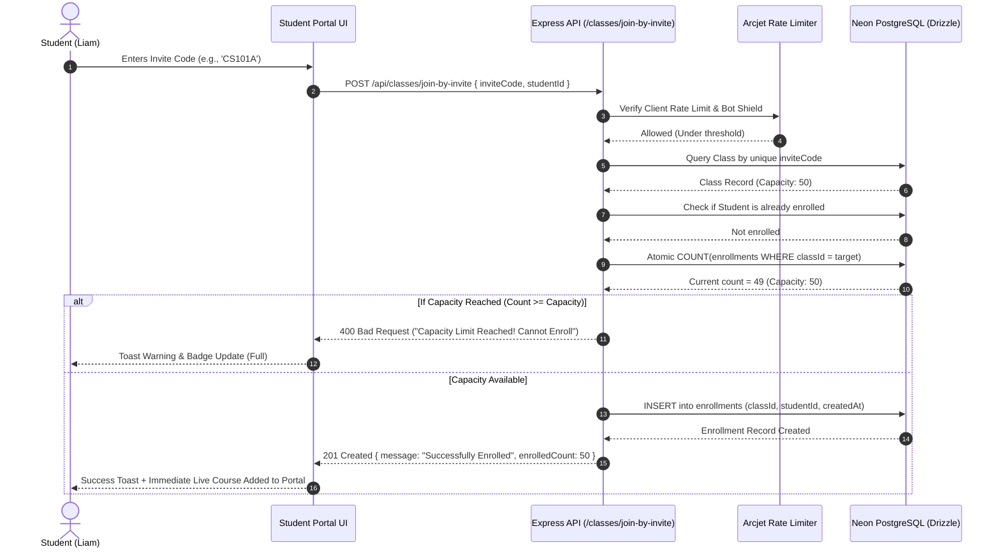

<div align="center">

# 🎓 UniManager
### Enterprise Academic Operations & Modern Classroom Management Platform

*A high-performance, full-stack university management portal built with **React 19**, **Refine v5**, **Tailwind CSS v4**, **TypeScript**, and an enterprise-grade **Express 5** & **Neon PostgreSQL** backend. Featuring granular Role-Based Access Control (RBAC), real-time capacity monitors, cryptographic class invite codes, and rich analytical dashboards.*

<br/>

[](https://react.dev/)
[](https://refine.dev/)
[](https://www.typescriptlang.org/)
[](https://vitejs.dev/)
[](https://tailwindcss.com/)
[](https://expressjs.com/)
[](https://neon.tech/)
[](https://orm.drizzle.team/)
[](https://arcjet.com/)
[](https://cloudinary.com/)

<br/>

[🚀 Explore Live Demo](#-live-demo--preview) • [📑 Backend Repository](https://github.com/ArchitDash12/classroom-backend) • [💡 Engineering Challenges](#-engineering-challenges-overcome-my-first-full-stack-journey) • [🛠️ Tech Stack](#%EF%B8%8F-comprehensive-tech-stack--badges) • [⚡ Quickstart](#-getting-started-locally)

</div>

---

## 📑 Table of Contents

- [🌟 Project Overview & Vision](#-project-overview--vision)
- [💎 Key Highlights & Capabilities](#-key-highlights--capabilities)
- [⚡ Live Demo & Preview](#-live-demo--preview)
- [🛠️ Comprehensive Tech Stack & Badges](#%EF%B8%8F-comprehensive-tech-stack--badges)
  - [Frontend Ecosystem](#frontend-ecosystem)
  - [Backend & Database Ecosystem](#backend--database-ecosystem)
  - [DevOps, Security & Cloud Services](#devops-security--cloud-services)
- [🏛️ Full System Architecture & Data Flow](#%EF%B8%8F-full-system-architecture--data-flow)
  - [High-Level Architecture](#high-level-architecture)
  - [Student Class Enrollment Sequence Flow](#student-class-enrollment-sequence-flow)
- [🖥️ UI & Feature Walkthrough](#%EF%B8%8F-ui--feature-walkthrough)
  - [1. Executive Analytics & Institutional KPI Dashboard](#1-executive-analytics--institutional-kpi-dashboard)
  - [2. Student Learning Portal & Weekly Timetable](#2-student-learning-portal--weekly-timetable)
  - [3. Interactive Course Catalog & Smart Data Table](#3-interactive-course-catalog--smart-data-table)
  - [4. Class Command Center & Real-Time Capacity Meter](#4-class-command-center--real-time-capacity-meter)
  - [5. One-Click Role Switcher & Auth Screen](#5-one-click-role-switcher--auth-screen)
- [🚀 Engineering Challenges Overcome (My First Full-Stack Journey)](#-engineering-challenges-overcome-my-first-full-stack-journey)
  - [Challenge 1: Multi-Role RBAC & Context-Aware UI Routing](#challenge-1-multi-role-rbac--context-aware-ui-routing)
  - [Challenge 2: Concurrency & Classroom Capacity Race Conditions](#challenge-2-concurrency--classroom-capacity-race-conditions)
  - [Challenge 3: Cryptographic Invite Code System & Frictionless Enrollment](#challenge-3-cryptographic-invite-code-system--frictionless-enrollment)
  - [Challenge 4: Referential Integrity & Active Student Enrollment Protection](#challenge-4-referential-integrity--active-student-enrollment-protection)
  - [Challenge 5: Direct-to-Edge Cloudinary CDN Upload Pipeline](#challenge-5-direct-to-edge-cloudinary-cdn-upload-pipeline)
  - [Challenge 6: Enterprise Security & Adaptive Role-Tiered Rate Limiting](#challenge-6-enterprise-security--adaptive-role-tiered-rate-limiting)
  - [Challenge 7: Enterprise TanStack Data Table & URL State Synchronization](#challenge-7-enterprise-tanstack-data-table--url-state-synchronization)
- [⚙️ Deep Dive: The Backend Behind The Scenes](#%EF%B8%8F-deep-dive-the-backend-behind-the-scenes)
- [🔐 Role-Based Access Control (RBAC) Matrix](#-role-based-access-control-rbac-matrix)
- [🔑 Instant Demo Credentials](#-instant-demo-credentials)
- [📂 Repository Directory Structure](#-repository-directory-structure)
- [⚡ Getting Started Locally](#-getting-started-locally)
- [🌐 Environment Variables](#-environment-variables)
- [🤝 Contributing & License](#-contributing--license)
- [👨‍💻 Author & Connect](#-author--connect)

---

## 🌟 Project Overview & Vision

**UniManager** was born out of a real-world frustration with fragmented, clunky university learning portals. Most institutional software suffers from archaic UI patterns, sluggish page reloads, poor mobile responsiveness, and opaque course registration systems where students have no visibility into batch capacities or schedule conflicts.

As my **first comprehensive full-stack application**, I set out to build an institutional-grade platform that bridges the gap between **high-powered administrative control** and a **delightful, frictionless student learning experience**. 

UniManager is not a simple CRUD template. It represents an end-to-end engineered system featuring:
- A responsive, headless enterprise frontend architecture powered by **Refine v5** and **React 19**.
- Beautifully crafted, accessible UI components built with **Tailwind CSS v4** and **shadcn/ui**.
- An asynchronous, serverless **Express 5** REST API backed by **Neon PostgreSQL** and **Drizzle ORM**.
- Real-time institutional telemetry, 14-day enrollment trends, and capacity risk warnings visualized via **Recharts**.
- Production-grade security with **Arcjet** bot detection, shield defenses, and adaptive role-based rate limiting.

---

## 💎 Key Highlights & Capabilities

- 🎯 **Dual Persona Experience (RBAC):** Tailored views for **Administrators / Faculty** (full institutional KPIs, department management, teacher assignments) and **Students** (personal enrolled course cards, weekly schedule timetable, one-click invite code join).
- 🎟️ **Instant Invite Code Enrollment:** 7-character collision-resistant keys generated for each class; students can enroll in seconds with real-time validation and one-click clipboard copying.
- 📊 **Real-Time Capacity Guardrails:** Visual color-coded capacity meters (`Available <80%`, `Warning 80-99%`, `Critical 100%`) with atomic server-side enforcement to eliminate over-enrollment.
- ⚡ **TanStack Table v8 Integration:** Advanced multi-column filtering by subject, teacher, status, and full-text keyword search, fully synchronized with browser query parameters (`syncWithLocation: true`).
- 🖼️ **Direct Cloud CDN Media Pipeline:** Seamless integration with **Cloudinary** for banner uploads and user avatars, bypassing server bandwidth bottlenecks.
- 🛡️ **Defensive Engineering & Error Boundaries:** React 19 error boundaries and transactional deletion guards preventing accidental data loss when deleting active courses or departments.
- 🌓 **Dynamic Theme Engine:** Native dark/light mode toggle with zero flicker using `next-themes`.

---

## ⚡ Live Demo & Preview

| Resource | Link |
|---|---|
| 🌐 **Frontend Application** | [classroom-frontend (GitHub Repo)](https://github.com/ArchitDash12/classroom-frontend) |
| 🔌 **Backend REST API** | [classroom-backend (GitHub Repo)](https://github.com/ArchitDash12/classroom-backend) |
| ☁️ **Production Backend API** | `https://classroom-backend-nuoy.onrender.com/` |

> *Tip: Try the one-click demo login on the authentication page to instantly switch between Admin, Teacher, and Student roles without typing credentials!*

---

## 🛠️ Comprehensive Tech Stack & Badges

UniManager leverages an industry-standard stack selected for speed, developer ergonomics, type safety, and scalability.

### Frontend Ecosystem

| Tool / Library | Badge | Purpose & Role in UniManager |
|---|---|---|
| **React 19** | `` | Component-driven UI runtime, React 19 hooks, and concurrency primitives |
| **Refine v5** | `` | Headless enterprise framework providing auth, data fetching, routing, and access control |
| **TypeScript** | `` | Strict end-to-end static typing across all UI states, API contracts, and form schemas |
| **Vite 6** | `` | Next-generation frontend tooling with lightning-fast HMR and optimized Rollup production builds |
| **Tailwind CSS v4** | `` | Cutting-edge utility-first styling with modern CSS variables and container queries |
| **shadcn/ui** | `` | Accessible, composable UI component primitives built on top of Radix UI |
| **Radix UI** | `` | Unstyled, fully accessible interactive primitives (Dialogs, Dropdowns, Progress, Tabs, Tooltips) |
| **TanStack Table v8** | `` | Headless UI table state engine powering the course catalog, user rosters, and subject directories |
| **React Hook Form** | `` | Performant, flexible forms with minimal re-renders for class creation and user administration |
| **Zod** | `` | TypeScript-first schema declaration and runtime validation for all forms and API payloads |
| **Recharts** | `` | Composable SVG visualization library rendering 14-day enrollment curves, bar charts, and donuts |
| **Lucide React** | `` | Beautiful, consistent icon set providing academic visual cues across navigation and metrics |
| **Sonner** | `` | Highly polished, non-intrusive toast notification system with progress indicators |
| **next-themes** | `` | Flawless dark and light theme switching with system preference detection |
| **Refine Kbar** | `` | Quick keyboard navigation (`Cmd+K` / `Ctrl+K`) across all resources |

---

### Backend & Database Ecosystem

| Tool / Technology | Badge | Purpose & Role in UniManager |
|---|---|---|
| **Express 5** | `` | High-performance Node.js HTTP server handling REST endpoints, routing, and error pipelines |
| **Node.js (ESM)** | `` | Modern ECMAScript module runtime powering the asynchronous backend architecture |
| **Neon PostgreSQL** | `` | Serverless PostgreSQL database with automated connection pooling and instant branching |
| **Drizzle ORM** | `` | Type-safe SQL ORM providing relational schema declarations and zero-overhead queries |
| **Drizzle Kit** | `` | Automated SQL migration generation, schema synchronization, and database inspection |
| **Better Auth** | `` | Session-based authentication framework handling cookies, passwords, and user identities |
| **tsx** | `` | Zero-config TypeScript execution engine for instantaneous development hot-reloads |

---

### DevOps, Security & Cloud Services

| Tool / Service | Badge | Purpose & Role in UniManager |
|---|---|---|
| **Arcjet** | `` | Security middleware providing AI bot protection, attack shielding, and adaptive rate limiting |
| **Cloudinary** | `` | Global media CDN handling client-side image transformation, compression, and secure storage |
| **Site24x7 APM** | `` | Real-time backend performance telemetry, request latency monitoring, and health tracking |
| **Render** | `` | Continuous cloud deployment and automated SSL hosting for the Express backend service |
| **Vercel** | `` | Edge deployment platform with asset compression and SPA client-side routing rewrites |

---

## 🏛️ Full System Architecture & Data Flow

UniManager is engineered as a decoupled full-stack architecture where the client maintains clean separation of concerns from data persistence and business logic.

### High-Level Architecture



---

### Student Class Enrollment Sequence Flow

This diagram illustrates how UniManager prevents race conditions and over-enrollment while keeping the user experience completely instantaneous:



---

## 🖥️ UI & Feature Walkthrough

### 1. Executive Analytics & Institutional KPI Dashboard
*(Visible to Administrators and Faculty)*

```
+----------------------------------------------------------------------------------------------------+
| 🎓 UniManager  |  Overview   Classes   Subjects   Departments   Users          [Dark]  [Admin: Sarah]  |
+----------------------------------------------------------------------------------------------------+
| Academic Overview                                                                [🔄 Refresh] [+ Class] |
| Real-time enrollment trends, capacity status, and institutional metrics.                           |
|                                                                                                    |
|  [ Total Users: 42 ]      [ Active Classes: 14 ]     [ Departments: 6 ]      [ Enrollments: 128 ]   |
|  30 Students | 8 Faculty   Avg Fill Rate: 78%         24 Registered Subjects   +18% this month     |
|                                                                                                    |
|  ⚠️ CAPACITY RISK WARNINGS (Live Alert Center)                                                     |
|  • CS101A: Introduction to Computer Systems [==============================] 50/50  CRITICAL FULL  |
|  • AI201B: Neural Network Architectures    [========================.....] 42/50  WARNING (84%)   |
|                                                                                                    |
|  +---------------------------------------+  +---------------------------------------------------+  |
|  | 📈 14-Day Enrollment Inflow (AreaChart) |  | 🏢 Class Distribution by Department (BarChart)     |  |
|  |        /\                             |  |  Computer Science  [████████████████████] 8        |  |
|  |       /  \    /\                      |  |  Artificial Intell [██████████████] 5             |  |
|  |  ____/    \__/  \____                 |  |  Design & HCI      [██████████] 4                 |  |
|  +---------------------------------------+  +---------------------------------------------------+  |
|                                                                                                    |
|  +---------------------------------------+  +---------------------------------------------------+  |
|  | 👥 Institutional User Ratio (Donut)   |  | ⚡ Quick Management Operations                    |  |
|  |  Students (71%) • Teachers (19%)      |  |  [+ New Course Batch]    [+ Register Student]     |  |
|  |  Admins (10%)                         |  |  [+ New Department]      [+ Assign Curriculum]    |  |
|  +---------------------------------------+  +---------------------------------------------------+  |
+----------------------------------------------------------------------------------------------------+
```

- **4 Core KPI Cards:** Real-time metrics for total student bodies, active course batches, curriculum breadth, and aggregate student enrollments.
- **Dynamic Capacity Risk Ticker:** Instantly alerts administrators whenever any classroom surpasses 80% capacity or reaches 100% full capacity.
- **Interactive SVG Charts:** Area trends with smooth cubic gradients, department breakdown bars, and user role distribution donuts built with **Recharts**.

---

### 2. Student Learning Portal & Weekly Timetable
*(Visible when logged in as a Student, e.g. Liam Johnson)*

```
+----------------------------------------------------------------------------------------------------+
| 🎓 UniManager  |  Overview   Classes                                       [Dark]  [Student: Liam]  |
+----------------------------------------------------------------------------------------------------+
| Welcome back, Liam! 🚀                                                                              |
| You are enrolled in 4 academic courses. Here is your active semester schedule.                    |
|                                                                                                    |
| 🔑 Join Class with Invite Code: [ CS101A               ]  [ 🎟️ Join Class ]                        |
|                                                                                                    |
| MY ENROLLED COURSES (4)                                  WEEKLY TIMETABLE                          |
| +-----------------------------+-------------------------+  • MON: 09:00 - 10:30                       |
| | [BANNER: Modern Systems]    | [BANNER: AI Lab]        |    CS101: Systems Programming            |
| | CS101 • Systems Programming | AI201 • Neural Networks |    Room 402 • Prof. Alex Rivera          |
| | Instructor: Prof. Rivera    | Instructor: Dr. Vance   |                                          |
| | 📅 Mon, Wed (09:00 - 10:30) | 📅 Tue, Thu (14:00)     |  • TUE: 14:00 - 15:30                       |
| | [ Open Course Room -> ]     | [ Open Course Room -> ] |    AI201: Neural Networks                |
| +-----------------------------+-------------------------+    Lab 3 • Dr. Marcus Vance              |
+----------------------------------------------------------------------------------------------------+
```

- **Frictionless Invite Bar:** Dedicated 7-character invite code input that immediately updates the student's personal roster.
- **Active Course Grid:** High-resolution banner cards displaying teacher avatars, subject codes, weekly session pills, and quick launch links.
- **Personalized Weekly Agenda:** Automatically aggregates schedule blocks from all enrolled classes into a chronological Monday–Friday timetable.

---

### 3. Interactive Course Catalog & Smart Data Table
*(Comprehensive filtering powered by TanStack Table v8)*

```
+----------------------------------------------------------------------------------------------------+
| 🔍 Search classes, codes, instructors...   [ Department: All v ]  [ Teacher: All v ]  [ Status: Active v ] |
+----------------------------------------------------------------------------------------------------+
| BANNER  CLASS NAME             SUBJECT         TEACHER        CAPACITY     INVITE CODE  ACTIONS    |
| [IMG]   Distributed Systems    CS301 (CompSci) Dr. Vance      48/50 [86%]  [ DIST89 📋]  [👁️] [✏️] [🗑️] |
| [IMG]   Web Architecture       CS204 (CompSci) Prof. Rivera   50/50 [FULL] [ WEB77X 📋]  [👁️] [✏️] [🔒] |
| [IMG]   UI/UX Design Systems   DES101 (Design) Elena Rostova  22/40 [55%]  [ DSGN14 📋]  [👁️] [✏️] [🗑️] |
+----------------------------------------------------------------------------------------------------+
| Showing 1 to 10 of 28 classes                              [<< First] [< Prev] [1] [2] [3] [Next >] |
+----------------------------------------------------------------------------------------------------+
```

- **Multi-Faceted Filtering:** Instant query filtering across class name, instructor, subject, and status (`Active`, `Inactive`, `Archived`).
- **URL Synchronization:** Uses Refine's `syncWithLocation` to keep filter parameters, pagination, and sorting directly reflected in browser URL search params for instant sharing and bookmarking.
- **Copy-to-Clipboard Action:** Invite codes can be copied with a single click, showing an interactive checkmark state and firing a Sonner toast notification.

---

### 4. Class Command Center & Real-Time Capacity Meter
*(Detailed Single Class View — `/classes/show/:id`)*

- **Interactive Capacity Progress Bar:** Color shifts from Emerald Green (`<80%`) to Amber Orange (`80-99%`) to Crimson Red (`100% full`).
- **Student Roster Administration:** Administrators can enroll students manually via dropdown selection, or remove students with an `AlertDialog` confirmation.
- **Over-Enrollment Protection:** The enrollment button automatically disables when the cap is reached, preventing accidental administrative over-subscription.
- **Cloudinary Dynamic Banners:** Supports rich custom banner artwork with fallback visual gradients.

---

### 5. One-Click Role Switcher & Auth Screen
*(Streamlined for rapid evaluation and testing)*

- **Pre-Configured Demo Pills:** Instant 1-click access buttons for:
  - 🛡️ **Administrator:** Sarah Mitchell (`admin@classroom.com`)
  - 🏫 **Faculty / Teacher:** Prof. Alex Rivera (`teacher@classroom.com`)
  - 🎓 **Student:** Liam Johnson (`student1@classroom.com`)
- **Real-Time Validation:** Powered by Zod and Better Auth credentials management.
- **Theme Consistency:** Floating theme toggle in the header allowing testing in dark and light modes.

---

## 🚀 Engineering Challenges Overcome (My First Full-Stack Journey)

Building UniManager as my first comprehensive full-stack project pushed me beyond surface-level tutorials. Here are the **real engineering obstacles** I encountered and the architectural decisions I made to conquer them.

---

### Challenge 1: Multi-Role RBAC & Context-Aware UI Routing

#### 🛑 The Problem
In early iterations, the dashboard was monolithic. Every user saw the same administrative KPI cards and management buttons. For students, this created confusion: they were shown global departmental analytics and institutional user tables that were completely irrelevant to their learning goals, while missing a clear view of their own enrolled classes and timetable. Furthermore, Refine's built-in resource routing mounted standard admin routes regardless of the user's role.

#### 💡 The Engineering Breakthrough
I architected a **Role-Based Dynamic Layout System**:
1. Implemented a custom `authProvider.getIdentity()` hook that queries the authenticated user profile and resolves their active role (`admin`, `teacher`, or `student`).
2. Engineered a higher-order conditional controller inside [`dashboard.tsx`](src/pages/dashboard.tsx) that checks `identity?.role === "student"`.
3. If the user is a student, the app dynamically branches to render `<StudentDashboard />`, which fetches `/api/enrollments/my`, compiles the student's personal timetable, and provides the invite-code enrollment card.
4. If the user is an admin or teacher, it renders `<AdminDashboard />` with high-level institutional telemetry and risk alerts.
5. Wrapped route outlets in an enterprise-grade [`<ErrorBoundary />`](src/components/error-boundary.tsx) so any unexpected parsing issue in a single component safely renders a graceful recovery widget instead of crashing the entire browser window.

---

### Challenge 2: Concurrency & Classroom Capacity Race Conditions

#### 🛑 The Problem
Physical classrooms have strict seating limitations (e.g., 50 students). In early testing, multiple students attempting to join simultaneously could cause a race condition where the database would register 51 or 52 enrollments before the client received the updated count. Additionally, naive client-side count checks were easily bypassed.

#### 💡 The Engineering Breakthrough
I implemented a **Two-Tier Capacity Defense**:
1. **Server-Side Atomic Enforcement:** In the Express backend route ([`classes.ts`](../classroom-backend/src/routes/classes.ts) and [`enrollments.ts`](../classroom-backend/src/routes/enrollments.ts)), every enrollment request executes an atomic SQL query:
   ```typescript
   const [countRow] = await db
     .select({ count: sql<number>`count(*)` })
     .from(enrollments)
     .where(eq(enrollments.classId, classId));

   const currentCount = Number(countRow?.count ?? 0);
   if (currentCount >= targetClass.capacity) {
     return res.status(400).json({
       error: `Capacity limit reached! This class is capped at ${targetClass.capacity} students (${currentCount}/${targetClass.capacity}).`,
     });
   }
   ```
2. **Aggregated Single-Pass Analytics:** To calculate fill rates on the dashboard without creating an $O(N)$ database query bottleneck (the classic N+1 query problem), I wrote a consolidated Drizzle SQL aggregation using `LEFT JOIN` and `COUNT(DISTINCT enrollments.id)` grouped by class.
3. **Reactive UI Indicators:** On the frontend, visual badges automatically display `Critical 100%` or `Warning 80%+`, and student join actions are disabled immediately when `enrolledCount >= capacity`.

---

### Challenge 3: Cryptographic Invite Code System & Frictionless Enrollment

#### 🛑 The Problem
Standard course registration systems require complex approval workflows or cumbersome alphanumeric IDs. However, purely random string generation caused three distinct problems:
- Lookalike glyph confusion (e.g., `O` vs `0`, `I` vs `1`, `S` vs `5`).
- Accidental casing errors when students entered codes on mobile devices.
- Potential database collisions if randomly generated strings overlapped.

#### 💡 The Engineering Breakthrough
1. **Unambiguous Alphabet:** Created an unambiguous base-32 character set:
   ```typescript
   const chars = "ABCDEFGHJKLMNPQRSTUVWXYZ23456789"; // Removed O, 0, I, 1
   ```
2. **Database Unique Constraint:** Added a PostgreSQL `UNIQUE` index on `classes.invite_code` to guarantee zero collisions at the persistence layer.
3. **Client-Side Ergonomics:** In the frontend join forms, input handlers automatically apply `.toUpperCase()`, sanitize whitespace, and enforce character length.
4. **Clipboard Bridge:** Added a dedicated copy action in [`classes/list.tsx`](src/pages/classes/list.tsx) and [`classes/show.tsx`](src/pages/classes/show.tsx) using `navigator.clipboard.writeText` with visual feedback that changes the icon to a green checkmark for 2 seconds and fires an immediate toast notification.

---

### Challenge 4: Referential Integrity & Active Student Enrollment Protection

#### 🛑 The Problem
In a relational university database, deleting a department or class that currently has active student enrollments can create severe data corruption, leaving orphaned foreign keys and causing analytics queries to crash with `null` pointer exceptions. On the other hand, silently cascading a deletion could wipe out months of student academic history without warning.

#### 💡 The Engineering Breakthrough
1. **Drizzle Foreign Key Constraints:** Configured explicit relational foreign key rules:
   ```typescript
   // Restrict deletion of departments if subjects reference them
   departmentId: integer('department_id').notNull().references(() => departments.id, { onDelete: 'restrict' })
   
   // Restrict deletion of teachers if classes reference them
   teacherId: text('teacher_id').notNull().references(() => user.id, { onDelete: 'restrict' })
   ```
2. **Client-Side Pre-Flight Check:** In [`classes/list.tsx`](src/pages/classes/list.tsx), before executing a deletion, the client checks `classDetails.enrolledCount > 0`. If active enrollments exist, the UI triggers a descriptive `AlertDialog`:
   > *"Cannot delete class with active student enrollments. Please unenroll or transfer all 24 students before removing this course."*
3. **Graceful Deletion Confirmation:** Standard deletions require an explicit confirmation modal, eliminating accidental one-click data loss.

---

### Challenge 5: Direct-to-Edge Cloudinary CDN Upload Pipeline

#### 🛑 The Problem
Uploading multi-megabyte image banners and avatars through the Node.js Express server caused high memory consumption, blocked the Node event loop during multipart file parsing, and slowed down request handling for other users on serverless instances.

#### 💡 The Engineering Breakthrough
I integrated **Cloudinary's Client-Side Upload Widget** ([`upload-widget.tsx`](src/components/upload-widget.tsx)):
1. The browser streams the image binary **directly to Cloudinary's global edge network** using an unsigned upload preset.
2. Cloudinary handles image compression, WebP format conversion, and thumbnail resizing at the edge.
3. The widget returns only the lightweight secure HTTPS URL (`url`) and public ID (`publicId`).
4. The React application sends only the metadata strings to the Express backend to be stored in PostgreSQL.
5. Zero binary overhead on the backend server; instantaneous uploads for users!

---

### Challenge 6: Enterprise Security & Adaptive Role-Tiered Rate Limiting

#### 🛑 The Problem
A publicly accessible API is vulnerable to malicious bot scrapers, brute-force credential stuffing, and Denial-of-Service attacks. However, applying a uniform rate limit penalizes legitimate administrators who need to perform batch operations (e.g., seeding or enrolling many students at once).

#### 💡 The Engineering Breakthrough
In [`security.ts`](../classroom-backend/src/middleware/security.ts), I implemented **Arcjet Security Middleware** with **Dynamic Role-Based Rate Limiting**:
- 🤖 **Bot Detection:** Automated traffic and malicious scrapers are blocked instantly with a `403 Forbidden`.
- 🛡️ **Shield Exploit Detection:** Inspects incoming payloads for SQL injection, cross-site scripting (XSS), and common CVE attack vectors.
- ⏱️ **Tiered Quotas:**
  - `Admin`: 300 requests/minute in development (20 req/min in prod).
  - `Teacher` / `Student`: 200 requests/minute in development (10 req/min in prod).
  - `Guest`: Strictly capped at 10 requests/minute to prevent unauthenticated resource exhaustion.

---

### Challenge 7: Enterprise TanStack Data Table & URL State Synchronization

#### 🛑 The Problem
In standard React applications, applying filters, page changes, and search queries stores state locally in `useState`. If a user refreshes the page, clicks the browser's "Back" button, or shares a link with a colleague, all search filters reset back to the default, creating a frustrating user experience.

#### 💡 The Engineering Breakthrough
I combined **Refine's `useTable` hook** with **TanStack Table v8** and enabled `syncWithLocation: true`:
1. Every filter modification (Subject dropdown, Teacher select, Status toggle, Pagination) is automatically serialized into browser query strings (e.g., `?subject=2&status=active&current=2`).
2. Reloading the browser preserves the exact table state, search keyword, and active page.
3. Users can bookmark or copy-paste the URL to immediately share filtered views with peers.
4. Server-side pagination and sorting are passed straight to Express Drizzle queries for optimal memory usage.

---

## ⚙️ Deep Dive: The Backend Behind The Scenes

While this repository houses the frontend application, a major portion of the engineering effort was spent designing and implementing the robust backend API in [`classroom-backend`](https://github.com/ArchitDash12/classroom-backend).

### What I Built in the Backend:

```
classroom-backend/
├── src/
│   ├── config/
│   │   └── arcjet.ts          # Arcjet client initialization & rule definitions
│   ├── db/
│   │   ├── index.ts           # Neon serverless connection pooling setup
│   │   └── schema/
│   │       ├── app.ts         # Tables: departments, subjects, classes, enrollments
│   │       ├── auth.ts        # Better Auth tables: user, session, account, verification
│   │       └── index.ts       # Unified schema export
│   ├── lib/
│   │   └── auth.ts            # Better Auth server configuration & role enums
│   ├── middleware/
│   │   └── security.ts        # Role-tiered rate limiting & bot defense
│   ├── routes/
│   │   ├── classes.ts         # Classes CRUD, schedules JSONB, invite codes
│   │   ├── dashboard.ts       # Aggregation engine: fill rates, 14-day trends, KPIs
│   │   ├── departments.ts     # Department management & referential checks
│   │   ├── enrollments.ts     # Student portal endpoints, invite verification
│   │   ├── subjects.ts        # Subject catalog with department relationships
│   │   └── users.ts           # User directory, role filtering & profiles
│   ├── index.ts               # Express 5 entry point, CORS & route mounts
│   └── seed.ts                # Rich university mock data population script
```

### Backend Architectural Highlights:
1. **Express 5 Native Async Handlers:** Utilized Express 5's modern error-handling pipeline where rejected promises in route handlers are automatically routed to error middleware without requiring boilerplate `try/catch` wrappers on every single route.
2. **Drizzle ORM Relational Schema:** Configured explicit Drizzle relations (`one-to-many` and `many-to-one`) allowing rich joined queries in a single query execution rather than manual multiple joins.
3. **JSONB Class Schedules:** Stored recurring weekly schedules (`day`, `startTime`, `endTime`) as a typed PostgreSQL `jsonb` array, allowing flexible multi-day lecture slots without requiring complex join tables for simple class timetables.
4. **Site24x7 APM Insight Telemetry:** Integrated APM Insight monitoring agent to capture real-time request latencies, database query execution times, and throughput metrics.
5. **Rich Organic Seeding:** Built [`seed.ts`](../classroom-backend/src/seed.ts) to populate realistic university data: 6 academic departments, 24 subjects, faculty instructors, active classrooms with schedules, and enrollments spanning 14 days to test time-series chart analytics.

---

## 🔐 Role-Based Access Control (RBAC) Matrix

| Feature / Resource | Administrator 🛡️ | Teacher / Faculty 🏫 | Student 🎓 |
|---|:---:|:---:|:---:|
| **Access Executive Analytics Dashboard** | ✅ Full Access | ✅ Full Access | ❌ (Redirects to Student Portal) |
| **Access Student Learning Portal** | ❌ | ❌ | ✅ Full Access |
| **Join Class via Invite Code** | ✅ | ✅ | ✅ Primary Action |
| **Browse Course Catalog** | ✅ View & Filter | ✅ View & Filter | ✅ View & Filter |
| **Create / Edit / Delete Classes** | ✅ Full CRUD | ✅ Assigned Classes | ❌ Read Only |
| **Manage Class Capacities & Schedules** | ✅ | ✅ | ❌ |
| **Manually Enroll / Unenroll Students** | ✅ | ✅ | ❌ |
| **Manage Academic Departments** | ✅ Full CRUD | 👁️ Read Only | ❌ No Access |
| **Manage Curricula & Subjects** | ✅ Full CRUD | 👁️ Read Only | ❌ No Access |
| **User Directory Administration** | ✅ Full CRUD | 👁️ View Roster | ❌ No Access |

---

## 🔑 Instant Demo Credentials

For quick evaluation, you can use the pre-populated demo buttons on the login screen, or sign in manually with these accounts:

| Role | Email | Password | Display Name |
|---|---|---|---|
| **Administrator** | `admin@classroom.com` | `admin123` | Sarah Mitchell |
| **Teacher** | `teacher@classroom.com` | `teacher123` | Prof. Alex Rivera |
| **Student** | `student1@classroom.com` | `student123` | Liam Johnson |

---

## 📂 Repository Directory Structure

```
classroom-frontend/
├── public/                    # Static assets & favicon
├── src/
│   ├── components/
│   │   ├── refine-ui/         # Refine specialized enterprise components
│   │   │   ├── buttons/       # Create, Edit, Show, Delete, Clone action buttons
│   │   │   ├── data-table/    # TanStack Table integration & pagination bars
│   │   │   ├── form/          # Form wrappers and field layouts
│   │   │   ├── layout/        # Sidebar, header, breadcrumbs, app shell
│   │   │   ├── notification/  # Sonner notification provider & toaster
│   │   │   ├── theme/         # ThemeProvider & Dark/Light mode toggle
│   │   │   └── views/         # Refine list, create, edit, show view wrappers
│   │   ├── ui/                # 40+ shadcn/ui accessible Radix primitives
│   │   ├── error-boundary.tsx # React 19 visual error boundary & fallback
│   │   └── upload-widget.tsx  # Cloudinary direct-to-edge upload component
│   ├── constants/             # API endpoints, Cloudinary presets & config
│   ├── hooks/                 # Custom React hooks (mobile detection, media queries)
│   ├── lib/                   # Utility helpers, Cloudinary URL generator, cn()
│   ├── pages/
│   │   ├── auth/              # Login & Signup pages with 1-click role switcher
│   │   ├── classes/           # Class catalog list, create, edit, show command center
│   │   ├── departments/       # Department CRUD administration
│   │   ├── subjects/          # Subject directory & curriculum management
│   │   ├── users/             # Student, teacher, and admin user rosters
│   │   └── dashboard.tsx      # Dual-mode analytics dashboard & student portal
│   ├── providers/
│   │   ├── auth.ts            # Better Auth client & role resolver
│   │   └── data.ts            # Custom Refine REST data provider adapter
│   ├── types/                 # Strict TypeScript interface declarations
│   ├── App.css                # Global styles & Tailwind CSS v4 imports
│   ├── App.tsx                # Application routing, Refine resource tree & providers
│   └── index.tsx              # DOM mounting point
├── components.json            # shadcn/ui configuration
├── Dockerfile                 # Containerized production build recipe
├── package.json               # Dependencies & build scripts
├── tsconfig.json              # TypeScript compiler configuration
└── vite.config.ts             # Vite bundler plugins & alias resolution
```

---

## ⚡ Getting Started Locally

### Prerequisites

Make sure you have installed:
- [Node.js](https://nodejs.org/) (version `18.0.0` or higher)
- [npm](https://www.npmjs.com/) (version `9.0.0` or higher)
- Running instance of the [`classroom-backend`](https://github.com/ArchitDash12/classroom-backend) API (locally on port `8000` or deployed on Render)

### 1. Clone the Repository

```bash
git clone https://github.com/ArchitDash12/classroom-frontend.git
cd classroom-frontend
```

### 2. Install Dependencies

```bash
npm install
```

### 3. Configure Environment Variables

Create a `.env` file in the root directory:

```env
# Backend API Endpoint
VITE_BACKEND_BASE_URL="http://localhost:8000/api/"

# Cloudinary CDN Configuration (Optional for local banner uploads)
VITE_CLOUDINARY_CLOUD_NAME=yhamvcf5
VITE_CLOUDINARY_UPLOAD_PRESET=classroom_app
VITE_CLOUDINARY_UPLOAD_URL=https://api.cloudinary.com/v1_1/yhamvcf5/image/upload
```

### 4. Run Development Server

```bash
npm run dev
```

Open [http://localhost:5173](http://localhost:5173) in your browser to experience UniManager.

### 5. Production Build & Preview

```bash
# Build optimized production bundle
npm run build

# Preview production build locally
npm run start
```

---

## 🌐 Environment Variables

| Variable | Required | Default | Description |
|---|:---:|---|---|
| `VITE_BACKEND_BASE_URL` | **Yes** | `http://localhost:8000/api/` | Base URL for the Express 5 REST API |
| `VITE_CLOUDINARY_CLOUD_NAME` | No | `yhamvcf5` | Cloudinary cloud account name |
| `VITE_CLOUDINARY_UPLOAD_PRESET`| No | `classroom_app` | Unsigned Cloudinary upload preset name |
| `VITE_CLOUDINARY_UPLOAD_URL` | No | `https://api.cloudinary.com/...` | Cloudinary REST upload endpoint |

---

## 🤝 Contributing & License

Contributions, feedback, and suggestions are warmly welcomed! If you find a bug or have an idea for an enhancement:

1. Fork the Project.
2. Create your Feature Branch (`git checkout -b feature/AmazingFeature`).
3. Commit your Changes (`git commit -m 'feat: add some amazing feature'`).
4. Push to the Branch (`git push origin feature/AmazingFeature`).
5. Open a Pull Request.

Distributed under the **MIT License**. See `LICENSE` for more information.

---

## 👨‍💻 Author & Connect

**Archit Dash**
- 🐙 **GitHub:** [@ArchitDash12](https://github.com/ArchitDash12)
- 💼 **Project Workspaces:** [classroom-frontend](https://github.com/ArchitDash12/classroom-frontend) • [classroom-backend](https://github.com/ArchitDash12/classroom-backend)
- 🎓 *First Full-Stack Software Engineering Project*

<br/>

<div align="center">

⭐ **If you found this project helpful or inspiring, please give it a star on GitHub!** ⭐

*Built with passion, late-night problem solving, and modern web standards.*

</div>
